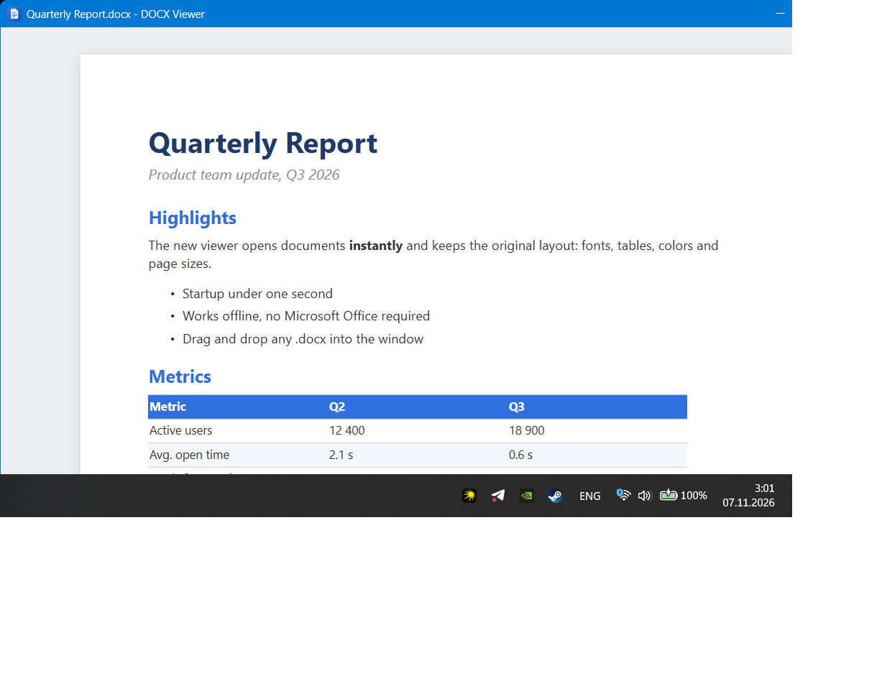

<p align="center"></p>

<h1 align="center">simple-docx</h1>

A tiny Windows app for when you just want to quickly look at a `.docx` without waiting for Word.



- Opens instantly, works offline, no Office needed
- Keeps the layout: fonts, colors, tables, pages
- Double-click any `.docx`, drag and drop, or Ctrl+O

## Install

Download [DocxViewer-Setup.exe](https://github.com/Kuchizu/simple-docx/releases/latest/download/DocxViewer-Setup.exe) and run it. No admin rights needed. Uninstall from Settings > Apps.

## Build

```powershell
powershell -ExecutionPolicy Bypass -File build.ps1
```

Output: `dist\DocxViewer-Setup.exe`. Built with WebView2 and a patched [docx-preview](https://github.com/Kuchizu/docxjs/tree/simple-docx) bundled in `vendor/`.
